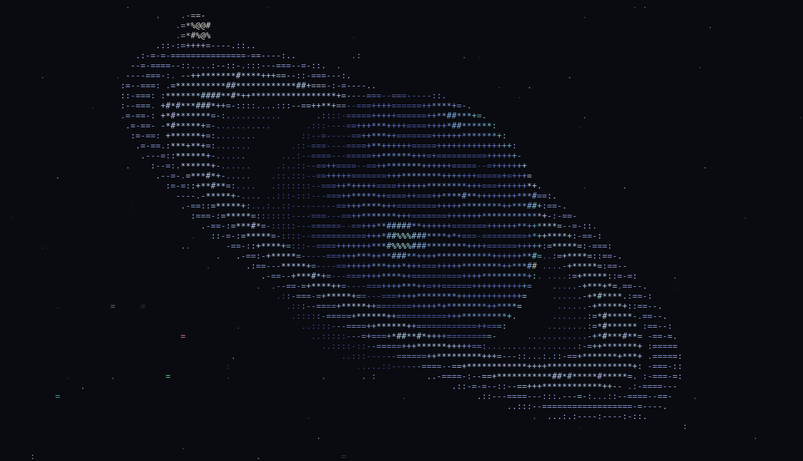

# saturn
*An animated ASCII Saturn for your terminal, written in C. The camera flies around the planet: the rings tilt, close edge-on and flip, and day turns to night and back.*

[](https://github.com/phanminhtai1029/saturn/actions/workflows/build.yml)
[](https://github.com/phanminhtai1029/saturn/releases/latest)
[](LICENSE)


---

## Preview

One full orbit, sped up 5x (in your terminal an orbit takes 60 seconds):


The starting pose:



## Features
- **Fully procedural 3D**: every frame is ray-cast into ASCII, so nothing is a canned animation and it fits any terminal size, even when you resize.
- **A camera orbiting on an inclined path**: the rings open wide, close into a bright edge-on line, then show their underside.
- **A fixed Sun**: the planet goes from full daylight to a thin backlit crescent and back. The Sun itself rises into view behind the planet.
- **Realistic rings**: C ring, the bright and dense B ring, the Cassini division, and the A ring with the Encke gap. Ring opacity follows optical depth, so the planet and rings shadow each other.
- **Moving details**: the planet spins with drifting storms, ring clumps orbit at Keplerian speed (inner rings move faster), a moon circles the system, stars stream past and twinkle, and shooting stars appear now and then.
- **24-bit colour when the terminal supports it**, with a 256-colour fallback.
- **Small and portable**: one C file with no dependencies beyond the C library. It redraws only changed cells and uses about 20-30% of one CPU core.

## Installation

### Linux
```bash
curl -fsSL https://raw.githubusercontent.com/phanminhtai1029/saturn/main/install/install.sh | sh
```
The installer downloads the prebuilt binary (x86_64 or arm64) to `~/.local/bin/saturn`, with no sudo. If `~/.local/bin` is not on your `PATH`, it prints the line to add to your shell config.

### macOS
```bash
curl -fsSL https://raw.githubusercontent.com/phanminhtai1029/saturn/main/install/install.sh | sh
```
The binary is universal, so it runs on both Apple Silicon and Intel Macs. On a fresh Mac, `~/.local/bin` is usually not on your `PATH`; the installer tells you how to add it, for example:
```bash
echo 'export PATH="$HOME/.local/bin:$PATH"' >> ~/.zshrc && source ~/.zshrc
```

### Windows 10 / 11
In PowerShell (no admin needed):
```powershell
irm https://raw.githubusercontent.com/phanminhtai1029/saturn/main/install/install.ps1 | iex
```
This installs `saturn.exe` into `%LOCALAPPDATA%\Programs\saturn` and adds that folder to your user `PATH`. Open a new terminal window afterwards. Windows Terminal is recommended. The classic console on Windows 10 and newer should also work, since it supports ANSI escape codes.

### Build from source (Latest Version)
You need a C compiler and `make`: `build-essential` on Debian/Ubuntu, `xcode-select --install` on macOS, or [MSYS2](https://www.msys2.org/) / MinGW-w64 on Windows.
```bash
git clone https://github.com/phanminhtai1029/saturn.git
cd saturn
make install            # installs to ~/.local/bin; use PREFIX=/usr/local for a system-wide install (with sudo)
```
`sh install/install.sh` run inside the clone does the same thing. On Windows with MinGW-w64, `make` produces `saturn.exe`.

### Manual download
Prebuilt binaries for every platform are attached to each [release](https://github.com/phanminhtai1029/saturn/releases/latest), with a `SHA256SUMS` file:

| File | Platform |
|---|---|
| `saturn-linux-x86_64` | Linux, 64-bit Intel/AMD (static) |
| `saturn-linux-arm64` | Linux, ARM64 such as Raspberry Pi 4/5 (static) |
| `saturn-macos-universal` | macOS 10.13+, Apple Silicon and Intel |
| `saturn-windows-x86_64.exe` | Windows 10/11, x64; also runs on ARM through emulation |

If you download through a browser, the system may block the file the first time:
- **macOS**: run `xattr -d com.apple.quarantine saturn-macos-universal`.
- **Windows**: SmartScreen shows a warning. Choose *More info*, then *Run anyway*, or run `Unblock-File .\saturn-windows-x86_64.exe`.

## Usage
```bash
saturn                  # start the animation (q, Esc or Ctrl+C to quit)
saturn -s 2             # twice as fast: one orbit in 30 seconds
saturn -s 0.5           # slow and calm
saturn -c 256           # force 256 colours (for terminals without 24-bit colour)
saturn -a 0.6           # planet looks squashed or stretched? set your font's cell width/height
saturn --dump 120x40 12 # print one frame at t = 12 s and exit (good for screenshots or scripts)
saturn --help
```

| Option | Meaning |
|---|---|
| `-s, --speed <x>` | Animation speed multiplier, default `1` |
| `-c, --colors <mode>` | `truecolor` or `256`; overrides auto-detection |
| `-a, --aspect <ratio>` | Character cell width divided by height, default `0.5` (most monospace fonts) |
| `--dump <COLSxROWS> <sec>` | Render a single frame to stdout |
| `-v, --version` | Show the version |

Colour detection uses `COLORTERM`, `TERM_PROGRAM` and the platform. You can also set it once with an environment variable: `export SATURN_COLORS=truecolor` (or `256`).

### Ricing tips
- Keep it running in a spare tmux pane or split for a live desktop.
- To greet yourself on login, add `alias space='saturn'` to your shell config instead of launching it automatically, because the animation takes over the terminal until you press `q`.

## Terminal support
Any terminal that understands ANSI escape codes works. The table only shows which colour mode is used.

| Terminal | Colours |
|---|---|
| GNOME Terminal, Konsole, kitty, Alacritty, WezTerm, foot, Ghostty | 24-bit |
| iTerm2, WezTerm, VS Code terminal (macOS) | 24-bit |
| macOS Terminal.app | 256 (auto fallback) |
| Windows Terminal, Windows 10+ console | 24-bit |
| tmux / screen | depends on the outer terminal; set `SATURN_COLORS=truecolor` if tmux is configured for RGB |

Every push is built and smoke-tested by [GitHub Actions](.github/workflows/build.yml) on Linux (x86_64 and arm64), macOS and Windows. The one-line installers are also tested against each release.

## How it works
- **Rendering**: each character cell is sampled at 2×4 points (cells are about twice as tall as they are wide). Each point is ray-cast against a sphere, the ring plane and the moon, front to back. Brightness then picks a glyph from ` .:-=+*#%@`, and the colour is the brightness-weighted average of the samples.
- **Camera**: the camera orbits on a path inclined 35° to the ring plane, with screen-up tied to the orbit normal. That is why the rings visibly turn: orbiting around the planet's own axis would leave a circular ring looking identical from every angle.
- **Rings**: the radii come from Saturn's real ring system, in planet radii: C 1.24-1.53, B 1.53-1.95, Cassini division 1.95-2.03, A 2.03-2.27, Encke gap at 2.21. Opacity is `1 - e^(-tau/mu)` (tau is the optical depth, mu the sine of the viewing angle above the ring plane), so thin rings are see-through, the B ring is nearly solid, and an edge-on ring closes into a line. Seen from the unlit side, the B ring is dark while the thinner rings glow when backlit.
- **Shadows**: a ray from each point towards the Sun decides whether the planet shadows the ring, or the ring (by its optical depth) shadows the planet.
- **Terminal output**: only cells that changed since the last frame are redrawn, inside synchronized-output markers so the frame never tears. The program uses the alternate screen and restores the terminal on exit, even after Ctrl+C.

## Customization
All tunables are `#define`s near the top of [`saturn.c`](saturn.c). Rebuild with `make install` after changing them.

| Constant | Default | Effect |
|---|---|---|
| `CAM_PERIOD` | `60` | Seconds per camera orbit |
| `CAM_INCL` | `35` | How far the rings tilt and flip, in degrees. Raise `SCENE_HH` too if you go higher |
| `SPIN` | `0.40` | Planet rotation speed, rad/s |
| `ORBIT` | `0.35` | Ring particle speed at r = 2, rad/s |
| `MOON_ORBIT`, `MOON_R` | `2.40`, `0.13` | Moon orbit radius and size, in planet radii |
| `METEOR_EVERY` | `4` | Seconds between shooting-star chances |
| `FPS` | `20` | Frame rate |

To regenerate the preview images after changing something: `python3 tools/make_preview.py` (needs Pillow).

## Uninstall
- **Linux / macOS**: `rm ~/.local/bin/saturn`, or `make uninstall` in the clone.
- **Windows**: delete `%LOCALAPPDATA%\Programs\saturn` and remove it from your user `PATH` (Settings, then *Edit environment variables for your account*).

## File Structure
```
saturn/
├── saturn.c                 # the whole program
├── Makefile
├── install/
│   ├── install.sh           # Linux / macOS installer
│   └── install.ps1          # Windows installer
├── tools/
│   └── make_preview.py      # renders assets/preview.gif from --dump frames
├── assets/                  # preview images used in this README
├── .github/workflows/
│   └── build.yml            # CI builds, smoke tests and releases
├── LICENSE
└── README.md
```

## Credits
- Inspired by [Momoisay](https://github.com/Mon4sm/Momoisay), the talking Momoi for the terminal.
- The starting pose and palette are modelled on the ASCII Saturn wallpaper [wallhaven-lyje9y](https://wallhaven.cc/w/lyje9y). The wallpaper is not included in this repository.

## License
[MIT](LICENSE)

---

## Hướng dẫn nhanh (Tiếng Việt)
**Cài đặt**
- **Linux / macOS**: `curl -fsSL https://raw.githubusercontent.com/phanminhtai1029/saturn/main/install/install.sh | sh`
- **Windows 10/11** (mở PowerShell): `irm https://raw.githubusercontent.com/phanminhtai1029/saturn/main/install/install.ps1 | iex`

**Chạy**: gõ `saturn`. Bấm `q`, `Esc` hoặc `Ctrl+C` để thoát.

**Tùy chọn hay dùng**
- `saturn -s 2`: chạy nhanh gấp đôi.
- `saturn -c 256`: dùng khi terminal không hiển thị được màu 24-bit.
- `saturn -a 0.6`: dùng khi hành tinh bị méo, bẹt hoặc dài ra (do font).

Muốn tự chỉnh tốc độ quay hay độ nghiêng của vành đai, sửa các hằng số ở đầu file `saturn.c` rồi chạy `make install`.
